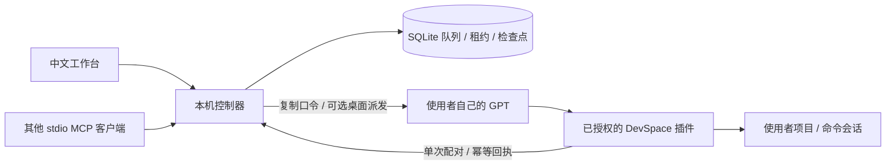

# 可移植架构

从原部署保留了串行工作槽、持久租约、幂等回执、断点、网页聊天派发及共享请求冷却语义。重新实现了与用户目录无关的配置、空白数据库、可独立安装的监督器、中文向导和按能力配对。原部署中的账号池、Heimdallr、QQ、SSH、个人长期记忆及生产监督脚本都不是本仓库依赖。

任务、执行事件、检查点、结果、租约与本地长期记忆使用本安装自己的 SQLite。项目知识与偏好按规范化真实路径隔离；显式用户偏好用于所有项目。新安装与旧版升级均创建空白记忆表，不回填或读取旧任务正文及其他安装。后续检查点/完成结果与任务回执同事务自动保存；中文分词和英文前缀检索为任务提供有界参考资料，不生成额外授权。详见 [本地记忆](LOCAL_MEMORY.md)。

## 模块

- `src/store.mjs`：SQLite WAL/FULL 事务、任务状态、事件、命令幂等表、单次配对口令。
- `src/memory.mjs`：SQLite FTS5 索引、用户/项目范围、修订冲突检查、自动记录及保留策略、忘记标记和有界检索上下文。执行器新增知识要求有效任务租约，不允许借任务凭据读写其他项目或用户范围。
- `src/plugins.mjs`：工具名称空间与 JSON Schema 识别；有界、只读 MCP 检测。目录不执行任何返回文本里的指令。
- `src/controller.mjs`：单槽调度，真实回执与展示状态分离，遇到未确认发送停止重发。
- `src/adapters/desktop-pipe.mjs`：可选 Windows 桌面私有桥接。读目标身份、确认已归档、重新检查空闲后才发送；发送之后遇断线标记未知，不跨管道重发。
- 桌面连接向导：通过环境或单次连接口令获得调用上下文，仅从归档列表读取元数据，用户按名称选择后绑定；不读取聊天正文、不创建聊天、不自动选择候选。绑定过程与派发共用持久冷却和执行互斥，任务在连接期间领取时中止换绑。
- `src/adapters/new-app-tool-admission.mjs`：读与发送共用持久冷却，429 不被误诊为管道损坏。
- `src/server.mjs`：仅回环 HTTP；本机随机凭据、Host/Origin 校验、有限静态资源、单任务执行凭据。
- `src/mcp-stdio.mjs`：标准 JSON-RPC 行式 stdio 任务接口；和实际执行命令的 DevSpace 服务分离。
- `scripts/supervisor.mjs`：无模型的本地进程监督；指数退避，不接管其他端口或进程。

## 生命周期

`queued → dispatching → waiting_executor → running → completed`。通用模式可以从 `queued` 直接领取为 `running`。

发送响应未知或派发中崩溃会进入 `delivery_unknown`；有效租约过期进入 `lease_expired`。这些状态继续占用执行槽，直到使用者核实并处理原执行器。暂停进入 `paused`，取消进入 `cancelled`。恢复会保留原任务 ID 与检查点。

所有任务操作都需要稳定 `commandId`：相同请求重试返回原回执，同一 ID 的内容改变会拒绝。领取与心跳不更新业务进度时间。完成必须有非空结果与验证证据；证据仍由执行器报告，工作台不是对任意项目测试正确性的独立裁判。

工作台显示最多 500 条任务并优先展示占用执行槽的任务，数据库不裁剪历史。队列领取与执行槽检查直接查询完整数据库，旧任务不会因为列表上限而被忽略或被新任务插队。

## 数据边界

本仓库不自动寻找或迁移任何旧安装。新配置只生成随机本机认证和安装标识；历史数据表为空。用户填写的项目、模型备注、向导保存的会话绑定和插件映射是本安装的私有运行数据。源码打包使用白名单，即使工作目录有额外数据库也不收录。

隐藏归档和记忆设置相互独立。Shell 不修改客户端全局记忆、不以归档状态证明记忆隔离。桌面公开桥接没有本项目所需的普通 GPT / 临时聊天创建或记忆设置核验接口；此限制与首次连接方式见 [隐藏会话说明](HIDDEN_EXECUTOR.md)。

浏览器认证只存在 URL 片段并立即移入会话存储，不进入 HTTP 查询参数。回连任务凭据只授权该任务的执行器操作，不授权设置、其他任务或停止服务。MCP stdio 客户端是本机可信进程，通过受保护的数据目录读取本安装认证。

## 故意保留的限制

不自动窃取客户端 OAuth Cookie；不从配置标签断言模型身份；不保证不兼容桌面私有管道可用；不在本机服务退出后凭心跳假装 GPT 仍持续工作；不自动恢复不确定的文件副作用。
